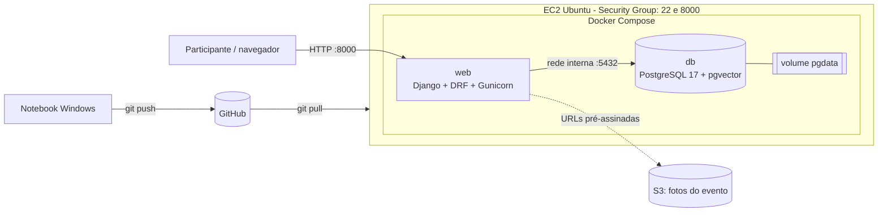
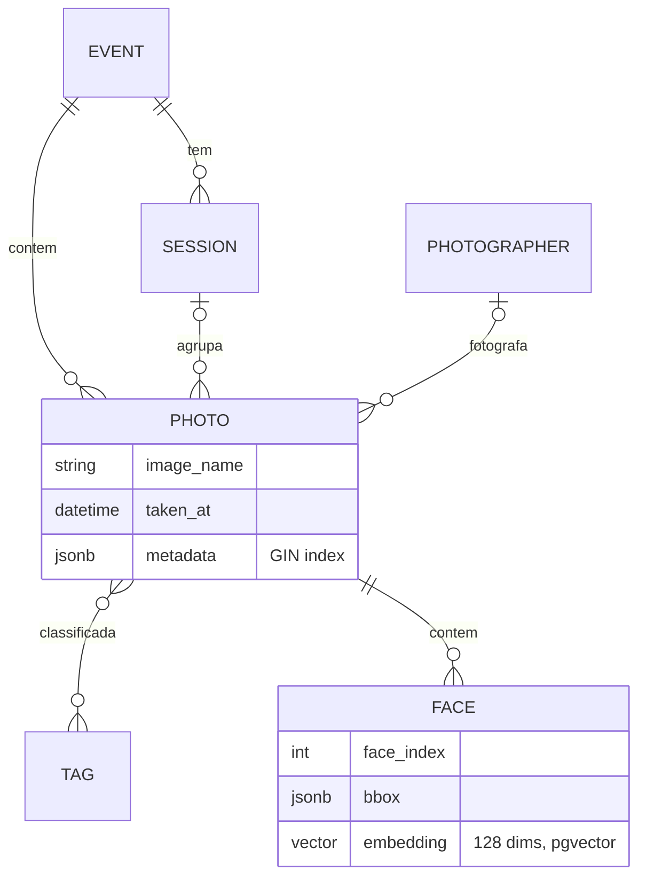

# PhotoMatch: API de busca facial para eventos

PhotoMatch encontra as fotos de um evento em que uma pessoa aparece a partir de uma selfie. Na AP1 o sistema rodou no Elastic Beanstalk com RDS e foi usado no SBrT 2026. Na AP2 ele passa a rodar em **uma instância EC2 com Docker Compose** (`web` + `db`), com **PostgreSQL multimodelo** em container: dados relacionais, documentos JSONB e vetores (pgvector).


## Links da entrega

| Item | Endereço |
|---|---|
| API publicada | `http://<IP-PUBLICO-EC2>:8000/api/` (preencher após o deploy) |
| Django Admin | `http://<IP-PUBLICO-EC2>:8000/admin/` |
| Documentação (MkDocs) | `https://projetos-de-extensao.github.io/PC_CDIA_26.2_8001_II/` (preencher após o `mkdocs gh-deploy`) |

## Arquitetura



O Postgres não publica porta no host: só o container `web` o alcança pela rede do Compose.

### Modelo de dados (multimodelo)



| Paradigma | Onde | Uso |
|---|---|---|
| Relacional (ACID) | `Event`, `Session`, `Photographer`, `Tag`, `Photo`, `Face` | 5 chaves estrangeiras e 1 ManyToMany (`Photo.tags`) |
| Documento (JSONB) | `Photo.metadata` com índice GIN `photo_metadata_gin` | câmera, ISO, lente, atributos livres; filtro `?metadata__camera__make=Canon` |
| Vetorial (pgvector) | `Face.embedding` (128 dimensões) | busca por similaridade (distância L2) em `POST /api/search/` |

## API

Leitura é pública; escrita exige login (sessão do Admin, `/api-auth/login/` ou HTTP Basic).

| Método | Rota | Descrição |
|---|---|---|
| GET/POST | `/api/events/` | eventos com sessões aninhadas e contagem de fotos |
| GET/PUT/PATCH/DELETE | `/api/events/<slug>/` | |
| CRUD | `/api/sessions/` (`?event=<slug>`), `/api/photographers/`, `/api/tags/`, `/api/faces/` (`?photo=<id>`) | |
| CRUD | `/api/photos/` | fotos com tags, fotógrafo e rostos aninhados |
| GET | `/api/photos/?metadata__camera__make=Canon&metadata__iso=800` | filtro em chaves JSONB (usa o índice GIN, operador `@>`) |
| GET | `/api/photos/?has_metadata=lens_mm`, `?tag=palestra`, `?event=demo-2026` | outros filtros |
| POST | `/api/photos/ingest/` | **transação**: cria foto, tags e rostos em `transaction.atomic()` |
| POST | `/api/search/` | **busca vetorial**: `{"embedding": [128 valores]}` ou `image` (multipart) |
| GET | `/health` | healthcheck |

### Regra de negócio transacional (`/api/photos/ingest/`)

Grava em `gallery_photo`, `gallery_tag`, `gallery_photo_tags` e `gallery_face`. Se qualquer regra falhar, **tudo é desfeito** (rollback) e a API responde 400:

1. a sessão pertence ao mesmo evento;
2. `taken_at` está dentro das datas do evento;
3. a foto tem de 1 a 50 rostos;
4. cada embedding tem exatamente 128 valores;
5. `face_index` não se repete na foto.

```bash
curl -u admin:<senha> -H "Content-Type: application/json" -X POST http://localhost:8000/api/photos/ingest/ -d '{
  "event": "demo-2026", "image_name": "teste_001.jpg", "taken_at": "2026-11-10T10:00:00-03:00",
  "metadata": {"camera": {"make": "Canon"}, "iso": 800}, "tags": ["palestra"],
  "faces": [{"face_index": 0, "bbox": {}, "embedding": [0.1, 0.2]}]
}'
# -> 400 {"detail": "Cada embedding precisa ter 128 valores (recebido: 2)."}  e nenhuma linha gravada
```

## Executar localmente (Docker)

Pré-requisito: Docker Desktop.

```bash
cp .env.example .env        # troque todos os valores "change-me"
docker compose up -d --build
docker compose logs -f web  # migrate, collectstatic, superusuário e dados demo
```

- API: http://localhost:8000/api/
- Admin: http://localhost:8000/admin/ (usuário e senha do `.env`)
- Busca facial (interface da AP1): http://localhost:8000/

O primeiro build compila o `dlib` e leva vários minutos.

### Testes

Os testes precisam de PostgreSQL com pgvector (JSONB, GIN e vetores não existem no SQLite):

```bash
docker compose exec web python manage.py test gallery search
```

Os 21 testes cobrem: transação com sucesso e quatro casos de rollback, filtros JSONB, existência do índice GIN, CRUD, permissão de escrita, busca vetorial, busca limitada ao evento escolhido, lista de eventos da página, proteção contra caminhos inválidos de foto, importação e o seed.

### Dados de exemplo

`SEED_DEMO=true` no `.env` cria, a cada inicialização e sem duplicar, o evento `demo-2026` com 3 sessões, 2 fotógrafos e 24 fotos com rostos sintéticos. Esse evento fica disponível na API, mas não aparece na página de busca (`published=False`). Para recriar: `docker compose exec web python manage.py seed_demo --reset`.

### Eventos reais

A página inicial lista os eventos publicados que têm rostos indexados. O participante escolhe o evento e a busca por selfie acontece só nas fotos dele. Cada evento guarda as fotos em uma pasta própria (`--prefix`), usada tanto no S3 (`dataset/<pasta>/`, `thumb/<pasta>/`) quanto nas pastas locais.

Para importar um evento a partir dos embeddings gerados pelo `face_engine` (arquivo `.pkl`, fora do Git):

```bash
docker compose exec web python manage.py import_pkl \
  --event sbrt-2025 --name "SBrT 2025" --starts-on 2025-09-29 --ends-on 2025-10-02 \
  --prefix sbrt2025/ --glob /photos/pkl/sbrt2025.pkl --images-dir /photos/dataset/sbrt2025
```

O comando cria o evento se ele não existir, cria as fotos e os rostos, e lê o EXIF de cada foto (data, câmera, lente, ISO) para preencher `taken_at` e o JSONB `metadata`. Um evento pode ser ocultado da página pelo Admin (campo "publicado").

Para ver as fotos localmente, copie `docker-compose.override.example.yml` para `docker-compose.override.yml` (ignorado pelo Git) e aponte as pastas de cada evento. Na EC2 as fotos vêm do bucket S3 (`S3_BUCKET`).

## Deploy na EC2: passo a passo

O roteiro completo, com custo e rollback, está em [`docs/Transicao/ativ_deploy.md`](docs/Transicao/ativ_deploy.md).

### 1. Instância e Security Group

1. Ubuntu Server 24.04 LTS, `t3.medium` (o build do dlib precisa de ~4 GB de RAM; ver `docs/Elaboracao/dim_comp.md`), disco gp3 de 20 GB.
2. Security Group com entrada **somente** para:
   - TCP 22 (SSH) a partir do seu IP;
   - TCP 8000 (API) a partir de `0.0.0.0/0`.

   A porta 5432 **não** é liberada.
3. Elastic IP associado à instância, para o IP não mudar.

### 2. Preparar a instância

```bash
ssh -i photomatch.pem ubuntu@<IP-PUBLICO>
git clone https://github.com/Projetos-de-Extensao/PC_CDIA_26.2_8001_II.git
sh PC_CDIA_26.2_8001_II/scripts/ec2-setup.sh   # Docker, Compose e Git; swap se RAM < 3 GB
exit                                           # reconecte para aplicar o grupo docker
```

### 3. Primeiro deploy

```bash
cd PC_CDIA_26.2_8001_II
cp .env.example .env && nano .env   # segredos reais só na EC2
sh scripts/deploy.sh                # git pull, up -d --build e espera o healthcheck
```

No `.env`, `DJANGO_ALLOWED_HOSTS` e `DJANGO_CSRF_TRUSTED_ORIGINS` precisam do IP público.

### 4. Fluxo de atualização (Windows → GitHub → EC2)

```bash
# no Windows
git add . && git commit -m "..." && git push
# na EC2
cd PC_CDIA_26.2_8001_II && sh scripts/deploy.sh
```

`migrate` e `collectstatic` rodam no `docker/entrypoint.sh` a cada inicialização do container.

### 5. Prova de persistência

```bash
docker compose exec db psql -U photomatch -d photomatch -c "SELECT count(*) FROM gallery_photo;"
docker compose down          # sem -v: o volume pgdata é mantido
docker compose up -d
docker compose exec db psql -U photomatch -d photomatch -c "SELECT count(*) FROM gallery_photo;"
```

A contagem é a mesma antes e depois. `docker compose down -v` apagaria o volume e não deve ser usado.

### 6. Backup e restauração

```bash
sh scripts/backup.sh                                   # pg_dump -Fc em ~/backups, retenção de 7 dias
sh scripts/restore.sh ~/backups/photomatch_<data>.dump # pg_restore --clean
```

Agendamento diário (`crontab -e`):

```
0 3 * * * cd /home/ubuntu/PC_CDIA_26.2_8001_II && sh scripts/backup.sh >> /home/ubuntu/backup.log 2>&1
```

Com `BACKUP_S3_URI=s3://<bucket>/backups/` o script também copia o arquivo para o S3.

### Scripts

| Script | Função |
|---|---|
| `scripts/ec2-setup.sh` | instala Docker, Compose e Git na EC2; cria swap se a RAM for menor que 3 GB |
| `scripts/deploy.sh` | `git pull`, `docker compose up -d --build`, espera o container ficar `healthy` |
| `scripts/backup.sh` | `pg_dump -Fc`, retenção local e cópia opcional no S3 |
| `scripts/restore.sh` | restaura um backup no container `db` |

## Evidências do deploy

Salve as capturas em `docs/assets/evidencias/` e referencie-as aqui:

- [ ] `docker ps` na EC2
- [ ] `docker compose logs web` (migrações e Gunicorn)
- [ ] `/api/` acessada pelo IP público
- [ ] Django Admin logado
- [ ] `psql` listando `gallery_photo` e `gallery_face`
- [ ] contagem igual antes e depois de `down`/`up`
- [ ] Security Group com 22 e 8000

## Segurança

- `.env` está no `.gitignore`; só `.env.example`, sem senhas reais, é versionado.
- Selfies enviadas para busca são processadas em memória e não são gravadas.
- As fotos do evento ficam em bucket S3 privado; a aplicação gera URLs pré-assinadas de curta duração.

## Histórico

- **AP1:** Django + Gunicorn em um container no Elastic Beanstalk, RDS PostgreSQL com pgvector, S3 e CloudFront. O passo a passo antigo está no histórico do Git.
- **AP2:** EC2 + Docker Compose, Postgres em container com volume, API DRF multimodelo, testes e documentação RUP.
