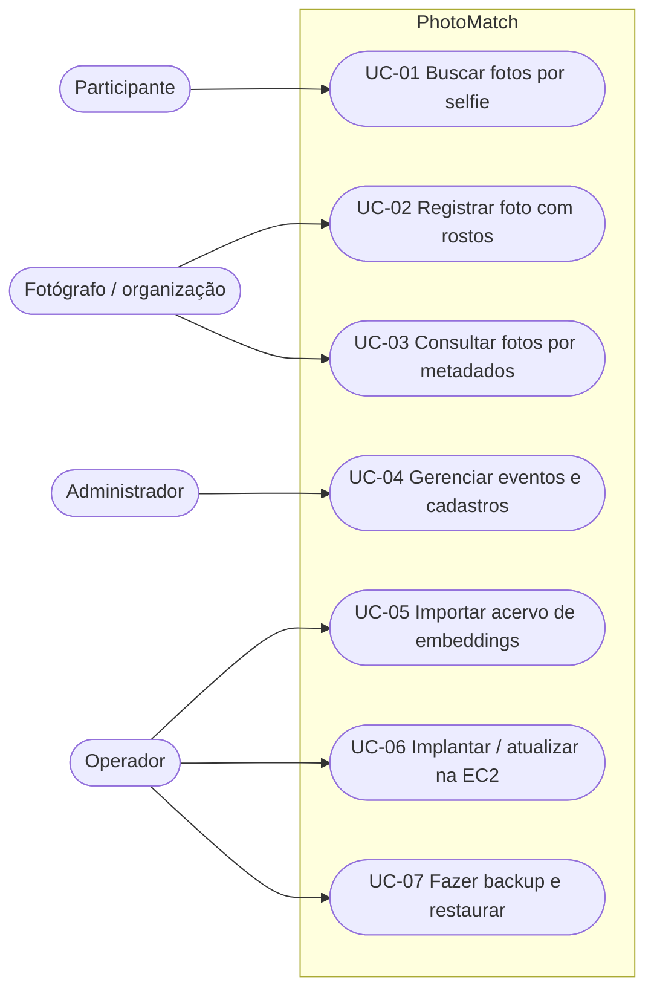

# Casos de Uso Arquiteturais (v2.0)

## SBrT PhotoMatch

**Fase:** Elaboração
**Data:** 11/11/2026

---

## 1. Introdução

### 1.1 Propósito

Descrever os casos de uso que definem a arquitetura do PhotoMatch na AP2: os que exercitam os três modelos de dados (relacional, documento e vetor), a transação de negócio e o ciclo de implantação na EC2.

### 1.2 Escopo

Os casos de uso cobrem a API Django, o banco PostgreSQL em container e a operação da instância EC2. A interface web de busca por selfie, herdada da AP1, aparece como UC-01.

### 1.3 Critério de significância

Um caso de uso é arquitetural quando: (a) usa mais de um componente ou modelo de dados, (b) tem requisito de consistência transacional, (c) depende de índice específico ou (d) envolve infraestrutura e segredos.

---

## 2. Atores

| Ator | Descrição |
|---|---|
| Participante | Pessoa fotografada no evento; usa a busca por selfie sem login. |
| Fotógrafo / organização | Registra fotos e consulta o acervo pela API (usuário autenticado). |
| Administrador | Gerencia dados pelo Django Admin. |
| Operador | Autor do projeto, que implanta e mantém a EC2. |
| PostgreSQL (sistema) | Banco multimodelo com pgvector. |
| Amazon S3 (sistema) | Armazena as fotos e gera URLs pré-assinadas. |

## 3. Diagrama de casos de uso

---

## 4. Especificação dos casos de uso

### UC-01 Buscar fotos por selfie

| Campo | Descrição |
|---|---|
| Ator | Participante |
| Requisitos | RF-01, RNF-PER-01, RNF-PER-02, RNF-SEG-05 |
| Pré-condição | Há rostos cadastrados (`gallery_face`). |
| Fluxo principal | 1. A página inicial lista os eventos publicados que têm rostos indexados; o participante escolhe um. 2. O participante envia uma selfie (ou `POST /api/search/` com `image` e `event`). 3. O `face_engine` detecta o rosto e calcula o embedding de 128 valores. 4. A consulta em `gallery_face` é limitada às fotos do evento escolhido, ordenada pela distância L2 (`<->` do pgvector) e filtrada por τ = 0,60. 5. As correspondências são agrupadas por foto. 6. A resposta lista as fotos do evento, a melhor distância e as URLs (pré-assinadas no S3, ou locais em desenvolvimento). |
| Fluxo alternativo | 1a. Há um só evento: ele já vem selecionado. 2a. Nenhum evento escolhido: resposta 400. 3a. Nenhum rosto detectado: resposta 422 com mensagem. 4a. Nenhuma foto abaixo de τ: mensagem de nenhuma correspondência no evento. |
| Pós-condição | Nenhum dado gravado; a selfie é descartada. |
| Componentes | `search.views`, `gallery.views.similarity_search`, `gallery.services.find_similar_photos`, `face_engine`, PostgreSQL/pgvector, S3 |

### UC-02 Registrar foto com rostos (transacional)

| Campo | Descrição |
|---|---|
| Ator | Fotógrafo / organização (autenticado) |
| Requisitos | RF-03, RNF-CON-02, RNF-SEG-04 |
| Pré-condição | O evento existe; o usuário está autenticado. |
| Fluxo principal | 1. `POST /api/photos/ingest/` com evento, sessão, fotógrafo, arquivo, data, metadados, etiquetas e rostos. 2. O serializer valida tipos e unicidade do arquivo. 3. `ingest_photo` abre `transaction.atomic()`. 4. Cria a `Photo`, cria ou reutiliza as `Tag` e preenche `gallery_photo_tags`. 5. Verifica as regras: sessão do mesmo evento, data dentro do evento, 1 a 50 rostos, embeddings de 128 valores. 6. Cria os `Face` em lote. 7. Confirma a transação e retorna 201 com a foto aninhada. |
| Fluxo de exceção | 5a/6a. Uma regra falha ou o `face_index` se repete: `BusinessRuleError`, rollback de todas as tabelas e resposta 400. |
| Pós-condição | Ou tudo é gravado (foto, etiquetas, ligações e rostos), ou nada. |
| Componentes | `gallery.views.PhotoViewSet.ingest`, `PhotoIngestSerializer`, `gallery.services.ingest_photo`, PostgreSQL |

### UC-03 Consultar fotos por metadados (JSONB)

| Campo | Descrição |
|---|---|
| Ator | Fotógrafo / organização (leitura pública) |
| Requisitos | RF-04, RNF-PER-03 |
| Fluxo principal | 1. `GET /api/photos/?metadata__camera__make=Canon&metadata__iso=800`. 2. `metadata_filter` transforma cada parâmetro em um documento aninhado e usa `metadata @> {...}`. 3. O PostgreSQL usa o índice GIN `photo_metadata_gin`. 4. A resposta é paginada (20 por página). |
| Variações | `?has_metadata=lens_mm` (chave existe), `?tag=`, `?event=`, `?session=`. |
| Componentes | `gallery.views.metadata_filter`, `PhotoViewSet`, índice GIN |

### UC-04 Gerenciar eventos e cadastros

| Campo | Descrição |
|---|---|
| Ator | Administrador ou usuário autenticado |
| Requisitos | RF-02, RF-06 |
| Fluxo principal | CRUD em `/api/events/` (por slug), `/api/sessions/`, `/api/photographers/`, `/api/tags/`, `/api/photos/`, `/api/faces/` ou pelo `/admin/`. |
| Regras | Fim do evento não pode ser antes do início (validação no serializer e `CheckConstraint` no banco); dia da sessão dentro do evento; e-mail do fotógrafo único. |

### UC-05 Importar acervo de embeddings

| Campo | Descrição |
|---|---|
| Ator | Operador |
| Requisitos | RF-05 |
| Fluxo principal | 1. O operador copia os arquivos `.pkl` para a EC2. 2. Executa `docker compose exec web python manage.py import_pkl --event <slug> --name "<nome>" --starts-on <data> --ends-on <data> --prefix <pasta>/ --glob "<arquivos>" --images-dir <fotos>`, que cria o evento se ele não existir e lê o EXIF de cada foto (data, câmera, lente, ISO) para `taken_at` e `metadata`. 3. Para cada arquivo, em uma transação, cria as fotos que faltam e insere os rostos em lote, ignorando duplicados. |

### UC-06 Implantar ou atualizar na EC2

| Campo | Descrição |
|---|---|
| Ator | Operador |
| Requisitos | RNF-OPS-03, RNF-SEG-01, RNF-SEG-02, RNF-DIS-03 |
| Fluxo principal | 1. Commit e `git push` no Windows. 2. SSH na EC2. 3. `sh scripts/deploy.sh`, que executa `git pull` e 4. `docker compose up -d --build`. 5. O Compose espera o `db` ficar saudável. 6. O entrypoint executa `migrate`, `collectstatic`, cria o superusuário se faltar e carrega o seed. 7. O Gunicorn sobe e o script espera o healthcheck passar. |
| Fluxo de exceção | 4a. Build falha: os containers antigos continuam rodando. 6a. Migração falha: o container `web` reinicia; rollback descrito em `../Transicao/ativ_deploy.md`. |

### UC-07 Fazer backup e restaurar

| Campo | Descrição |
|---|---|
| Ator | Operador |
| Requisitos | RNF-OPS-04 |
| Fluxo principal | `sh scripts/backup.sh` (agendado no cron às 03:00) gera um `pg_dump -Fc`, apaga cópias com mais de 7 dias e, com `BACKUP_S3_URI`, envia ao S3. Restauração com `sh scripts/restore.sh <arquivo>`. |

---

## 5. Matriz de rastreabilidade

| Requisito | Caso de uso | Componente | Teste / evidência |
|---|---|---|---|
| RF-01 Busca por selfie no evento escolhido | UC-01 | `search.views.home_view`, `find_similar_photos(event=...)`, pgvector | `test_vector_search_returns_closest_photo_first`, `test_search_only_returns_photos_of_the_chosen_event`, `test_post_without_event_is_rejected_when_there_is_a_choice` |
| RF-02 CRUD | UC-04 | ViewSets DRF | `test_event_crud`, `test_event_end_before_start_is_rejected` |
| RF-03 Registro transacional | UC-02 | `ingest_photo` | `test_ingest_writes_photo_tags_and_faces`, `test_bad_embedding_rolls_back_every_table`, `test_duplicate_face_index_rolls_back`, `test_photo_outside_event_dates_is_rejected`, `test_session_from_other_event_is_rejected` |
| RF-04 Metadados JSONB | UC-03 | `metadata_filter`, índice GIN | `test_filter_by_nested_json_key`, `test_filter_matches_typed_json_value`, `test_metadata_has_gin_index` |
| RF-05 Importação | UC-05 | `import_pkl` | `test_import_creates_event_and_prefixes_photo_paths`; SBrT 2025 importado: 1.219 fotos, 3.344 rostos |
| RF-08 Publicação de eventos | UC-04 | `Event.published`, `published_events()` | `test_page_lists_only_published_events_with_faces` |
| RF-06 Admin | UC-04 | `gallery/admin.py` | captura do Admin no README |
| RF-07 Seed | UC-04 | `seed_demo` | `test_seed_demo_is_idempotent` |
| RNF-SEG-04 Escrita autenticada | UC-02, UC-04 | `IsAuthenticatedOrReadOnly` | `test_anonymous_users_cannot_write` |
| RNF-CON-01 Persistência | UC-06 | volume `pgdata` | contagem antes e depois de `down`/`up` (README) |
| RNF-OPS-03 Deploy | UC-06 | `docker-compose.yml`, `entrypoint.sh` | `docker ps` e logs (README) |
| RNF-OPS-04 Backup | UC-07 | `scripts/backup.sh`, `scripts/restore.sh` | backup de 84 KB restaurado com 24 fotos (11/11/2026) |

---

## 6. Histórico de versões

| Versão | Data | Descrição | Autor |
|---|---|---|---|
| 1.0 | 11/11/2026 | Casos de uso da arquitetura AP2 | Nicholas Borges de Vasconcelos |
