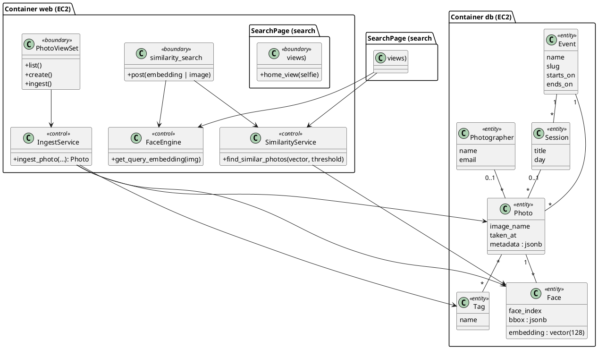

# Dimensionamento Computacional (EC2) (v1.0)

## SBrT PhotoMatch

**Fase:** Elaboração
**Data:** 11/11/2026

---

## 1. Objetivo

Escolher o tipo de instância EC2 que roda os containers `web` (Django + Gunicorn + dlib) e `db` (PostgreSQL 17 + pgvector) na mesma máquina, com base em medições feitas no ambiente Docker local em 11/11/2026.

## 2. Medições

| Medida | Valor | Como foi medido |
|---|---|---|
| Imagem `web` | 1,41 GB | `docker image ls` |
| Imagem `pgvector/pgvector:pg17` | 627 MB | `docker image ls` |
| Memória do `web` em repouso (Gunicorn, 3 workers) | 175 MB | `docker stats` |
| Memória do `db` em repouso | 26 MB | `docker stats` |
| Memória de um processo após carregar os modelos do dlib | 191 MB | `ru_maxrss` dentro do container |
| Busca vetorial `POST /api/search/` (embedding pronto) | p50 2,7 ms, p95 4,2 ms | 30 requisições dentro do container |

## 3. Orçamento de memória no pico

No pior caso, os três workers do Gunicorn atendem buscas por selfie ao mesmo tempo e cada um carrega o dlib.

| Componente | Memória |
|---|---|
| Ubuntu + Docker Engine | 400 MB |
| PostgreSQL (`shared_buffers` 128 MB, conexões e cache) | 250 MB |
| Gunicorn: processo mestre | 50 MB |
| Gunicorn: 3 workers × 191 MB | 573 MB |
| Margem para picos de imagem (decodificação de fotos de celular) | 300 MB |
| **Total em operação** | **≈ 1,6 GB** |

O build da imagem é o momento de maior uso: a compilação do dlib em C++ consome vários GB de RAM, e em instâncias de 2 GB pode ser encerrada por falta de memória.

## 4. Comparação de instâncias

Preços on-demand de referência na região us-east-1 (conferir na AWS Pricing Calculator antes de contratar).

| Tipo | vCPU | RAM | US$/hora | US$/mês (730 h) | Uso de RAM em operação | Build do dlib | Decisão |
|---|---|---|---|---|---|---|---|
| t3.micro | 2 | 1 GB | 0,0104 | 7,59 | 160% | não cabe | rejeitada |
| t3.small | 2 | 2 GB | 0,0208 | 15,18 | 80% | só com swap | alternativa econômica |
| **t3.medium** | **2** | **4 GB** | **0,0416** | **30,37** | **40%** | **cabe** | **escolhida** |
| t3.large | 2 | 8 GB | 0,0832 | 60,74 | 20% | cabe | superdimensionada |

**Justificativa da t3.medium:** mantém o uso de RAM em operação abaixo de 70% (RNF-CAP-01), compila o dlib sem swap e deixa folga para o PostgreSQL usar cache. A família t3 é burstable: o uso de CPU é baixo na maior parte do tempo e só sobe nas buscas por selfie, o que combina com o modelo de créditos de CPU.

**Alternativa:** t3.small com 2 GB de swap reduz o custo da instância para US$ 15,18/mês, ao custo de builds mais lentos e risco de troca para disco no pico.

## 5. Custo mensal estimado

| Item | Cálculo | US$/mês |
|---|---|---|
| EC2 t3.medium | 730 h × 0,0416 | 30,37 |
| EBS gp3 20 GB (SO, imagens Docker, volume do banco) | 20 × 0,08 | 1,60 |
| IPv4 público (ou Elastic IP associado) | 730 h × 0,005 | 3,65 |
| S3: fotos do acervo (≈ 6 GB) e backups | 6 × 0,023 | 0,14 |
| Transferência de saída | primeiros 100 GB/mês gratuitos | 0,00 |
| **Total** | | **≈ 35,76** |

Fica dentro do teto de US$ 40 (RNF-CUS-01). Parar a instância fora dos períodos de uso reduz o custo da EC2 proporcionalmente, mas troca o IP público se não houver Elastic IP.

## 6. Classes de análise

Classes de fronteira (boundary), controle e entidade do PhotoMatch e o nó de execução de cada uma.

## 7. Ajustes de capacidade

| Situação | Ação |
|---|---|
| CPU acima de 70% por muito tempo (créditos esgotando) | Ativar modo `unlimited` da t3 ou subir para t3.large |
| Buscas por selfie enfileirando | Aumentar workers do Gunicorn (`--workers`), limitado pela RAM: cada worker com dlib usa ≈ 190 MB |
| Muitos eventos no mesmo banco | Ver `dimrbd.md` (índice HNSW, disco) |

## 8. Histórico de versões

| Versão | Data | Descrição | Autor |
|---|---|---|---|
| 1.0 | 11/11/2026 | Dimensionamento com medições do ambiente Docker | Nicholas Borges de Vasconcelos |
