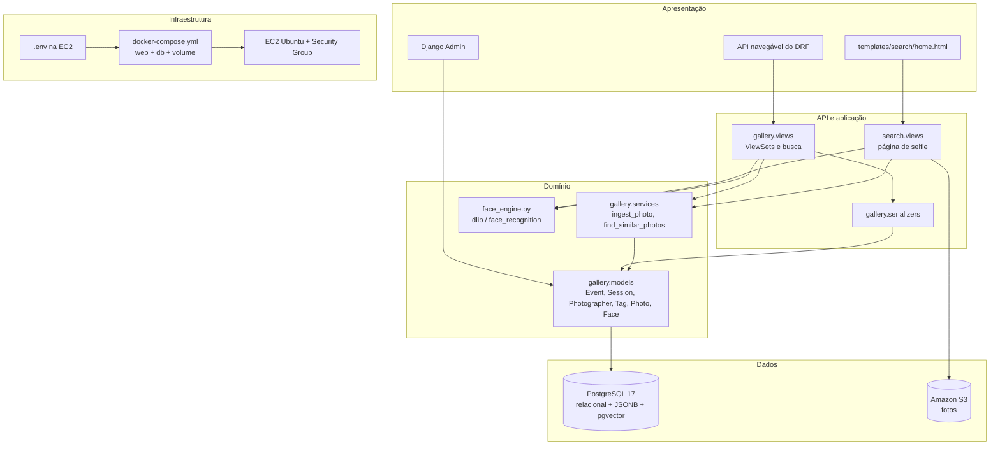
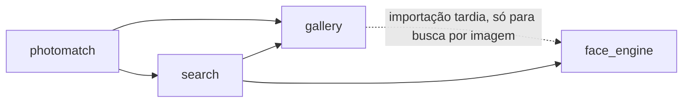

# Pacotes e Subsistemas (v1.0)

## SBrT PhotoMatch

**Fase:** Elaboração
**Data:** 11/11/2026

---

## 1. Visão geral

O sistema é dividido em cinco camadas. Cada camada depende só das camadas abaixo dela.

## 2. Pacotes

| Pacote | Responsabilidade | Arquivos principais | Depende de |
|---|---|---|---|
| `photomatch` (projeto Django) | Configuração, rotas raiz, WSGI | `settings.py`, `urls.py`, `wsgi.py` | variáveis de ambiente |
| `gallery` (app do tema) | Modelo de dados, API REST, regras de negócio, comandos | `models.py`, `serializers.py`, `views.py`, `services.py`, `admin.py`, `management/commands/` | Django, DRF, pgvector |
| `search` (app da AP1) | Página de busca por selfie e URLs de foto | `views.py`, `services.py`, `s3.py`, `runtime.py` | `gallery`, `face_engine`, boto3 |
| `face_engine` | Detecção de rosto e cálculo de embedding | `face_engine.py` | face_recognition, dlib, OpenCV, numpy |
| `docker` | Inicialização do container | `docker/entrypoint.sh` | `manage.py` |
| Infraestrutura | Build e orquestração | `Dockerfile`, `docker-compose.yml`, `.env.example` | Docker, imagem `pgvector/pgvector:pg17` |
| Documentação | Site MkDocs | `docs/`, `mkdocs.yml` | mkdocs-material, mkdocs_puml |

## 3. Subsistemas

### 3.1 API (`gallery.views`, `gallery.serializers`)

- `DefaultRouter` em `/api/` registra seis ViewSets com CRUD completo.
- Serializers aninhados: o evento traz suas sessões; a foto traz etiquetas, fotógrafo e rostos (sem o vetor).
- Ação `ingest` e função `similarity_search` concentram as operações de negócio.
- Permissão padrão `IsAuthenticatedOrReadOnly`; paginação de 20 itens.

### 3.2 Dados (`gallery.models`)

| Tabela | Modelo de dados | Relações |
|---|---|---|
| `gallery_event` | relacional | 1:N com sessões e fotos |
| `gallery_session` | relacional | N:1 com evento (FK) |
| `gallery_photographer` | relacional | 1:N com fotos |
| `gallery_tag` | relacional | N:N com fotos |
| `gallery_photo` | relacional + documento (`metadata` JSONB, índice GIN) | FKs para evento, sessão e fotógrafo |
| `gallery_photo_tags` | tabela associativa | ManyToMany foto ↔ etiqueta |
| `gallery_face` | relacional + vetor (`embedding vector(128)`) + documento (`bbox`) | N:1 com foto, único por (foto, face_index) |

### 3.3 Infraestrutura

| Elemento | Configuração |
|---|---|
| Container `web` | imagem construída do `Dockerfile` (Python 3.12, dlib compilado, usuário não root), porta 8000, healthcheck `/health` |
| Container `db` | `pgvector/pgvector:pg17`, sem porta publicada, healthcheck `pg_isready` |
| Volume `pgdata` | `/var/lib/postgresql/data` |
| Rede | rede padrão do Compose; `web` acessa `db:5432` |
| Segredos | `.env` na EC2, lido por `env_file` |

### 3.4 Segurança

| Camada | Controle |
|---|---|
| Rede | Security Group com 22 (IP do operador) e 8000; Postgres sem porta pública |
| Aplicação | `IsAuthenticatedOrReadOnly`; CSRF; `ALLOWED_HOSTS` e `CSRF_TRUSTED_ORIGINS` do ambiente |
| Container | usuário `app` sem privilégios |
| Dados | segredos fora do Git; selfies não persistidas; bucket S3 privado |

## 4. Dependências entre pacotes

`gallery` só importa `face_engine` dentro da busca por imagem. Assim, os testes e o CRUD não carregam o dlib.

## 5. Rastreabilidade pacote × requisito

| Requisito | `gallery` | `search` | `face_engine` | Infraestrutura |
|---|---|---|---|---|
| RF-01 Busca por selfie | X | X | X | |
| RF-02 CRUD | X | | | |
| RF-03 Transação | X | | | |
| RF-04 JSONB | X | | | |
| RF-05 Importação | X | | | |
| RNF-SEG-01 Segredos | | | | X |
| RNF-SEG-02 Banco fechado | | | | X |
| RNF-CON-01 Persistência | | | | X |
| RNF-OPS-03 Deploy | | | | X |

## 6. Histórico de versões

| Versão | Data | Descrição | Autor |
|---|---|---|---|
| 1.0 | 11/11/2026 | Pacotes e subsistemas da AP2 | Nicholas Borges de Vasconcelos |
