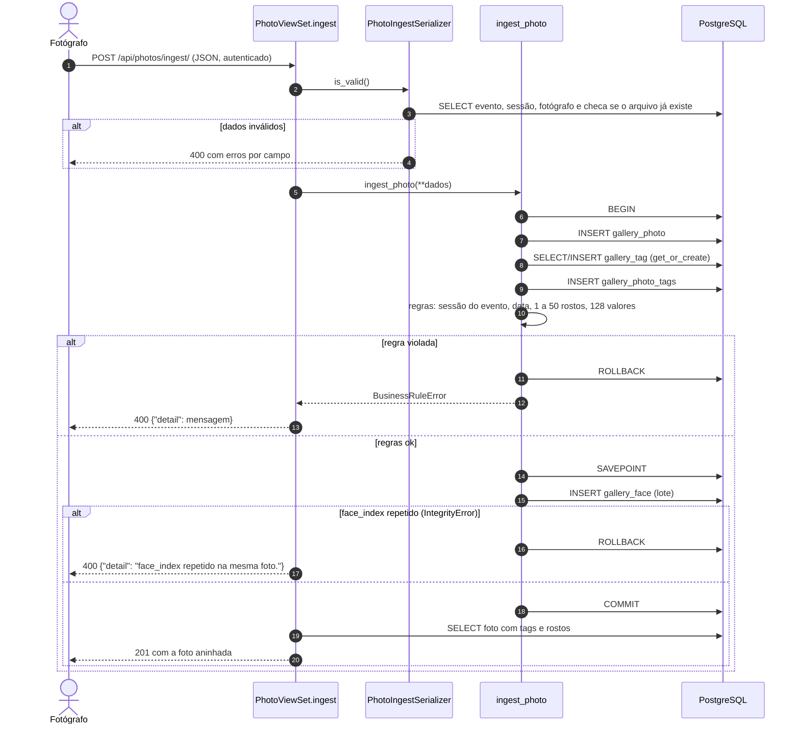
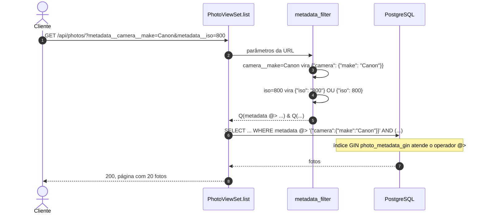
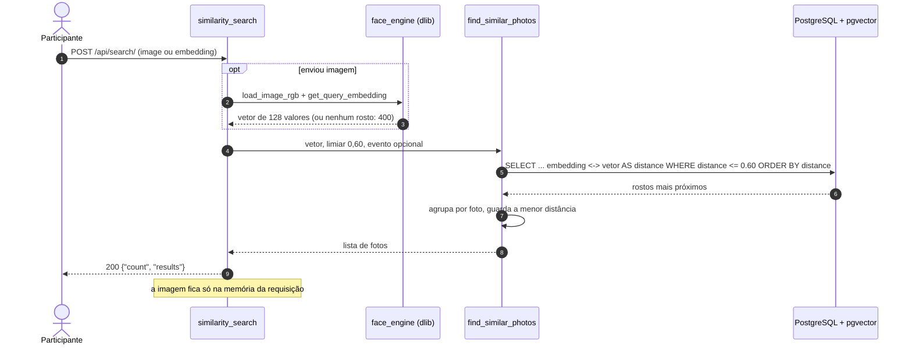
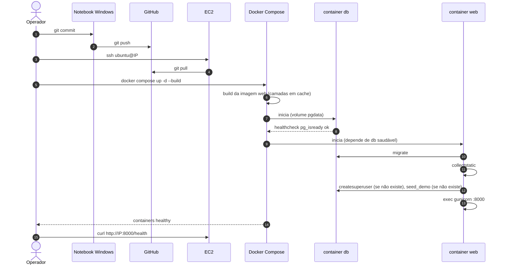
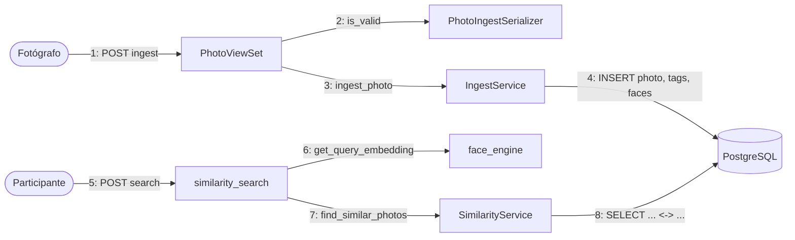

# Diagramas de Sequência e Comunicação (v1.0)

## SBrT PhotoMatch

**Fase:** Elaboração
**Data:** 11/11/2026

---

## 1. Fluxos críticos

| Fluxo | Por que é crítico | Caso de uso |
|---|---|---|
| Registro transacional de foto | grava em quatro tabelas e precisa de rollback | UC-02 |
| Consulta por metadados JSONB | depende do índice GIN | UC-03 |
| Busca por similaridade | une o motor de rosto e o pgvector | UC-01 |
| Deploy na EC2 | envolve Git, Docker, segredos e migrações | UC-06 |

## 2. Registro transacional de foto (UC-02)

## 3. Consulta por metadados JSONB (UC-03)

## 4. Busca por similaridade (UC-01)

## 5. Deploy na EC2 (UC-06)

## 6. Diagrama de comunicação

Mensagens numeradas entre os objetos no registro de foto e na busca.

## 7. Matriz de rastreabilidade

| Requisito | Caso de uso | Fluxo / diagrama | Componente | Teste / evidência |
|---|---|---|---|---|
| RF-03, RNF-CON-02 | UC-02 | seção 2 | `ingest_photo` | `test_ingest_writes_photo_tags_and_faces`, `test_bad_embedding_rolls_back_every_table`, `test_duplicate_face_index_rolls_back` |
| RF-04, RNF-PER-03 | UC-03 | seção 3 | `metadata_filter`, índice GIN | `test_filter_by_nested_json_key`, `test_filter_matches_typed_json_value`, `test_metadata_has_gin_index` |
| RF-01, RNF-PER-01 | UC-01 | seção 4 | `find_similar_photos`, pgvector | `test_vector_search_returns_closest_photo_first`; p95 de 4,2 ms medido |
| RNF-OPS-03, RNF-DIS-03 | UC-06 | seção 5 | `docker-compose.yml`, `entrypoint.sh` | logs do `web` e `docker ps` no README |
| RNF-CON-01 | UC-06 | seção 5 | volume `pgdata` | contagem antes e depois de `down`/`up` |

## 8. Histórico de versões

| Versão | Data | Descrição | Autor |
|---|---|---|---|
| 1.0 | 11/11/2026 | Fluxos críticos da AP2 | Nicholas Borges de Vasconcelos |
