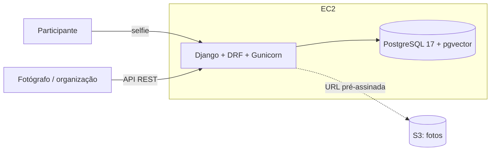

# Documento de Visão (v2.0)

## SBrT PhotoMatch: recuperação de fotos de eventos por reconhecimento facial

**Disciplina:** Projeto de Cloud (PC_CDIA_26.2_8001)
**Fase:** Iniciação, revisada para a AP2
**Data:** 11/11/2026
**Status:** Aprovado para a entrega da AP2

---

## 1. Introdução

### 1.1 Propósito

Este documento define a visão do **SBrT PhotoMatch**, aplicação web e API que permite a participantes de um evento encontrar, a partir de uma selfie, as fotos oficiais em que aparecem. A versão 1.0 (AP1) descreveu o sistema usado ao vivo no SBrT 2026 (29/09 a 02/10/2026), hospedado no Elastic Beanstalk com RDS. Esta versão 2.0 registra a evolução pedida na AP2: execução em **uma instância EC2 com Docker Compose**, banco **PostgreSQL multimodelo em container** e uma **API REST** que organiza o acervo por evento, sessão, fotógrafo e etiquetas.

### 1.2 Escopo

Dentro do escopo:

1. Busca de fotos por selfie (interface web da AP1, mantida).
2. API REST (Django REST Framework) com CRUD de eventos, sessões, fotógrafos, etiquetas, fotos e rostos.
3. Registro transacional de uma foto com seus rostos e etiquetas (`POST /api/photos/ingest/`).
4. Metadados flexíveis de cada foto em JSONB (câmera, lente, ISO, atributos livres), com filtro pela API.
5. Busca vetorial por similaridade de rosto com pgvector (`POST /api/search/`).
6. Deploy em EC2 com containers `web` e `db`, volume persistente e segredos fora do Git.

Fora do escopo: reprocessamento em massa do acervo (os embeddings vêm da fase de pesquisa e são importados com `import_pkl`), cadastro de participantes e armazenamento de selfies.

### 1.3 Definições e siglas

| Termo | Significado |
|---|---|
| Embedding | Vetor de 128 números que representa um rosto (dlib ResNet). |
| τ (limiar) | Distância euclidiana máxima para considerar dois rostos a mesma pessoa: 0,60, definido no artigo. |
| JSONB | Tipo binário de documento JSON do PostgreSQL, indexável. |
| GIN | Índice invertido do PostgreSQL usado para buscas de contenção (`@>`) em JSONB. |
| pgvector | Extensão do PostgreSQL que adiciona o tipo `vector` e operadores de distância. |
| EC2 | Servidor virtual da AWS. |
| Docker Compose | Ferramenta que sobe vários containers descritos em `docker-compose.yml`. |
| LGPD | Lei Geral de Proteção de Dados (Lei nº 13.709/2018). |

### 1.4 Referências

- Vasconcelos et al., *Designing a Face Recognition System for Event Photography*, SBrT 2026.
- Enunciado da AP2: Django API Multimodelo (PostgreSQL) em Docker na EC2 + Documentação RUP.
- Documentação do Django (campos específicos do PostgreSQL), do Django REST Framework e do Docker Compose.

---

## 2. Posicionamento

### 2.1 Oportunidade

Participantes de eventos técnicos raramente recebem as fotos em que aparecem. No SBrT 2026 o PhotoMatch mostrou que uma selfie basta para encontrá-las. Na AP2 o sistema deixa de ser exclusivo de um evento: a página lista os eventos disponíveis, o participante escolhe o seu e a busca acontece só nas fotos dele. Cada evento tem suas sessões, fotógrafos e fotos, e cada foto tem metadados diferentes conforme a câmera e o fotógrafo.

### 2.2 Descrição do problema

| | |
|---|---|
| **O problema de** | procurar manualmente as próprias fotos em um acervo de mais de mil imagens, e de manter acervos de vários eventos em uma base só |
| **afeta** | participantes, fotógrafos e a organização de eventos acadêmicos |
| **cujo impacto é** | fotos nunca recuperadas, trabalho repetido a cada evento e custo de infraestrutura gerenciada desproporcional ao uso |
| **uma solução bem-sucedida** | encontra as fotos em segundos, organiza o acervo por evento com metadados flexíveis e roda com custo previsível em uma única instância |

### 2.3 Posicionamento do produto

Para organizadores e participantes de eventos acadêmicos, o PhotoMatch é uma API e um site que recuperam fotos por reconhecimento facial. Diferente de galerias estáticas ou da busca manual, combina dados relacionais (evento, sessão, fotógrafo), documentos (metadados JSONB) e vetores (rostos) no mesmo PostgreSQL.

---

## 3. Stakeholders e usuários

| Stakeholder | Necessidade principal | Expectativa |
|---|---|---|
| Participante do evento | Encontrar as próprias fotos rapidamente | Resposta em poucos segundos pelo celular, sem cadastro |
| Fotógrafo ou organização do evento | Registrar fotos com metadados e consultar o acervo | API documentada, filtros por evento, sessão, etiqueta e câmera |
| Operador (autor do projeto) | Implantar e atualizar com um fluxo simples | `sh scripts/deploy.sh` na EC2 (`git pull` + `docker compose up -d --build`) |
| Professor (cliente da AP2) | Arquitetura sem Beanstalk e sem SQLite, documentada | Requisitos A1–A8 e B1–B8 atendidos e rastreáveis |

---

## 4. Visão geral da solução

### 4.1 Perspectiva do produto

### 4.2 Funcionalidades

| ID | Funcionalidade |
|---|---|
| RF-01 | Escolher o evento e buscar as próprias fotos por selfie apenas nesse evento (página inicial e `POST /api/search/` com imagem ou embedding e `event`). |
| RF-02 | Manter eventos, sessões, fotógrafos, etiquetas, fotos e rostos (CRUD na API e no Admin). |
| RF-03 | Registrar uma foto com rostos e etiquetas em uma única transação, com rollback se uma regra falhar. |
| RF-04 | Guardar metadados livres por foto em JSONB e filtrar fotos por qualquer chave (`?metadata__camera__make=Canon`). |
| RF-05 | Importar o acervo de embeddings gerado na pesquisa (`import_pkl`). |
| RF-06 | Administrar os dados pelo Django Admin. |
| RF-07 | Carregar dados de demonstração para testes e apresentação (`seed_demo`), sem exibi-los na página pública. |
| RF-08 | Publicar ou ocultar um evento na página de busca (`Event.published`, editável no Admin). |

### 4.3 Suposições e dependências

- O acervo de um evento tem a ordem de grandeza do SBrT 2025: cerca de 1.500 fotos e 3.500 rostos.
- Os embeddings são gerados por `face_recognition` (dlib), já validado no artigo.
- As fotos ficam em um bucket S3 privado; o banco guarda apenas o nome do arquivo.

---

## 5. Recursos da arquitetura

| Recurso | Papel | Justificativa |
|---|---|---|
| Amazon EC2 (Ubuntu 24.04, t3.medium) | Hospeda Docker e os containers | Uma instância basta para o volume de um evento; substitui o Beanstalk por decisão do cliente |
| Docker Compose (`web`, `db`) | Empacota aplicação e banco | Mesmo ambiente no Windows e na EC2; deploy repetível |
| PostgreSQL 17 + pgvector (container) | Banco relacional, documental e vetorial | Substitui o SQLite e o RDS; um único banco para os três modelos |
| Volume Docker `pgdata` | Persistência do banco | Dados sobrevivem a `down`/`up` e a novos builds |
| Gunicorn | Servidor WSGI | Mais robusto que o `runserver`; 3 workers |
| Amazon S3 | Fotos do acervo | Mantido da AP1; o servidor não serve imagens grandes |
| Security Group | Firewall da instância | Libera somente 22 (SSH) e 8000 (API); 5432 fechado |

---

## 6. Restrições

- **Tecnológicas:** Django, DRF, PostgreSQL com psycopg, Docker Compose e EC2, conforme o enunciado da AP2.
- **Prazo:** entrega em 13/11/2026; a API precisa ficar no ar até a avaliação.
- **Orçamento:** conta acadêmica; meta de até US$ 40 por mês com a instância ligada o mês todo (ver `dim_comp.md`).
- **Segurança:** nenhum segredo no Git; Postgres sem porta pública.
- **Pessoal:** projeto individual (Nicholas Borges de Vasconcelos), responsável por desenvolvimento, deploy e documentação.
- **Privacidade (LGPD):** selfies processadas em memória e descartadas após a resposta.

---

## 7. Atributos de qualidade

| Atributo | Meta |
|---|---|
| Desempenho | Busca vetorial com p95 abaixo de 500 ms no servidor (medido: 4,2 ms com dados de demonstração); busca por selfie abaixo de 5 s |
| Disponibilidade | API no ar durante o período de avaliação; reinício automático dos containers (`restart: unless-stopped`) |
| Persistência | Nenhuma perda de dados em reinício de containers ou da instância |
| Segurança | Escrita na API só com usuário autenticado; segredos apenas no `.env` da EC2 |
| Manutenibilidade | Deploy completo com três comandos; 21 testes automatizados |

---

## 8. Histórico de versões e aprovação

| Versão | Data | Descrição | Autor |
|---|---|---|---|
| 1.0 | 04/09/2026 | Versão inicial (AP1): Beanstalk, RDS, S3 e CloudFront | Nicholas Borges de Vasconcelos |
| 2.0 | 11/11/2026 | Revisão para a AP2: EC2 + Docker Compose, PostgreSQL multimodelo em container, API REST | Nicholas Borges de Vasconcelos |

| Papel | Nome | Decisão | Data |
|---|---|---|---|
| Responsável técnico | Nicholas Borges de Vasconcelos | Aprovado | 11/11/2026 |
| Cliente / avaliador | Prof. Jonh Carvalho | Avaliação na apresentação da AP2 | 13/11/2026 |
