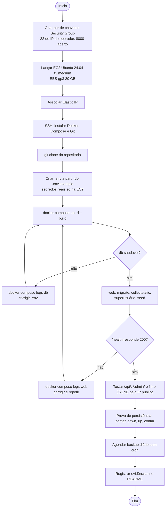

# Atividades de Deploy (v1.0)

## SBrT PhotoMatch

**Fase:** Transição
**Data:** 11/11/2026

---

## 1. Estratégias avaliadas

| Estratégia | Como funciona | Prós | Contras | Custo mensal estimado |
|---|---|---|---|---|
| Elastic Beanstalk (AP1) | um container Docker gerenciado, com ALB e Auto Scaling | escala sozinho, health checks, deploy com `eb deploy` | dependência pedida para ser removida; menos controle; ALB pago mesmo ocioso | ≈ US$ 35 (t3.small + ALB) + RDS |
| **EC2 + Docker Compose (escolhida)** | uma instância com containers `web` e `db` | controle total, mesmo Compose no notebook e na nuvem, uma cobrança só | instância única sem redundância; backup manual | **≈ US$ 36** |
| EC2 + Docker + RDS | containers `web` na EC2, banco no RDS | backup automático e Multi-AZ opcional | segunda cobrança; não atende o B2 (Postgres em container) | ≈ US$ 50 |
| ECS Fargate + RDS | containers sem servidor | sem gerenciar instância, escala por tarefa | mais configuração (VPC, ALB, task definitions); custo maior | ≈ US$ 70 |

**Escolha:** EC2 + Docker Compose. Atende a todos os requisitos B1–B8, tem o menor custo com a instância ligada o mês todo e repete exatamente o ambiente testado localmente.

## 2. Diagrama de atividades do deploy realizado



## 3. Passo a passo

### 3.1 Provisionamento (Console AWS)

1. **Security Group** `photomatch-sg`:
   - entrada TCP 22, origem: o IP do operador (`/32`);
   - entrada TCP 8000, origem: `0.0.0.0/0`;
   - nenhuma regra para 5432; saída liberada.
2. **Instância:** Ubuntu Server 24.04 LTS, `t3.medium`, EBS gp3 20 GB, o Security Group acima e um par de chaves novo (`photomatch.pem`).
3. **Elastic IP:** alocar e associar à instância, para o IP não mudar se ela for reiniciada.

### 3.2 Preparação da instância

```bash
ssh -i photomatch.pem ubuntu@<ELASTIC-IP>
git clone https://github.com/Projetos-de-Extensao/PC_CDIA_26.2_8001_II.git
sh PC_CDIA_26.2_8001_II/scripts/ec2-setup.sh   # Docker, Compose, Git; swap se RAM < 3 GB
exit   # reconectar para aplicar o grupo docker
```

### 3.3 Primeira implantação

```bash
cd PC_CDIA_26.2_8001_II
cp .env.example .env
python3 -c "import secrets; print(secrets.token_urlsafe(50))"   # DJANGO_SECRET_KEY
nano .env   # chave, senhas e o IP em DJANGO_ALLOWED_HOSTS / DJANGO_CSRF_TRUSTED_ORIGINS
sh scripts/deploy.sh          # git pull, up -d --build, espera o healthcheck
curl http://localhost:8000/health
```

### 3.4 Atualizações

```bash
# Windows
git push
# EC2
cd PC_CDIA_26.2_8001_II && sh scripts/deploy.sh
```

### 3.5 Backup diário

```bash
crontab -e
# 03:00 todos os dias; retenção de 7 dias em /home/ubuntu/backups
0 3 * * * cd /home/ubuntu/PC_CDIA_26.2_8001_II && sh scripts/backup.sh >> /home/ubuntu/backup.log 2>&1
```

## 4. Estimativa de tempo

| Atividade | Tempo |
|---|---|
| Security Group, instância e Elastic IP | 15 min |
| Instalar Docker, Compose e Git | 10 min |
| Clonar e configurar o `.env` | 10 min |
| Primeiro build (compilação do dlib) | 15 a 25 min |
| Verificação, persistência e evidências | 20 min |
| **Primeiro deploy completo** | **≈ 1h30** |
| Atualização (camadas em cache) | 2 a 5 min |

## 5. Custo

| Item | US$/mês |
|---|---|
| EC2 t3.medium | 30,37 |
| EBS gp3 20 GB | 1,60 |
| Elastic IP / IPv4 público | 3,65 |
| S3 (fotos e backups) | 0,14 |
| **Total** | **≈ 35,76** |

Detalhes e alternativas em [Dimensionamento Computacional](../Elaboracao/dim_comp.md).

## 6. Plano de rollback

| Situação | Ação | Tempo |
|---|---|---|
| Build falha | Nada muda: os containers antigos continuam rodando. Corrigir e repetir. | imediato |
| Nova versão sobe, mas com erro de código | `git log --oneline` → `git checkout <commit-anterior>` → `docker compose up -d --build` (não usar o `deploy.sh` aqui, porque ele faz `git pull`) | 5 min |
| Migração nova quebra o banco | `docker compose exec web python manage.py migrate gallery <migração-anterior>`, depois voltar o código como acima | 5 a 10 min |
| Dados corrompidos ou apagados | `sh scripts/restore.sh /home/ubuntu/backups/<último-backup>.dump` | 5 min |
| Instância perdida | Nova EC2 pelo passo 3.1–3.3, restaurar o último backup do S3, reassociar o Elastic IP | 30 min |

Regra de operação: **nunca** usar `docker compose down -v`, que apaga o volume do banco.

## 7. Checklist de aceite

- [ ] `docker ps` mostra `web` e `db` com status `healthy`
- [ ] `http://<ELASTIC-IP>:8000/api/` responde pelo navegador
- [ ] login no `/admin/` com o superusuário do `.env`
- [ ] `/api/photos/?metadata__camera__make=Nikon` retorna só fotos Nikon
- [ ] contagem de `gallery_photo` igual antes e depois de `down`/`up`
- [ ] porta 5432 inacessível de fora (`nc -zv <ELASTIC-IP> 5432` falha)
- [ ] evidências salvas no README

## 8. Histórico de versões

| Versão | Data | Descrição | Autor |
|---|---|---|---|
| 1.0 | 11/11/2026 | Estratégias, deploy em EC2 + Docker Compose, custo e rollback | Nicholas Borges de Vasconcelos |
