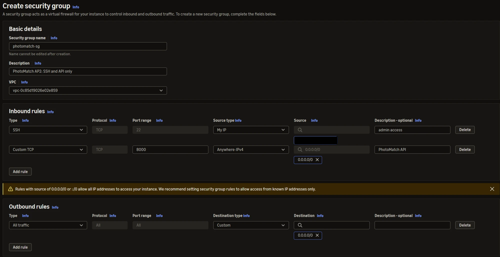
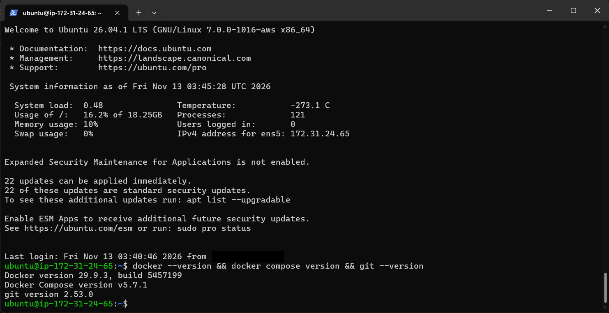
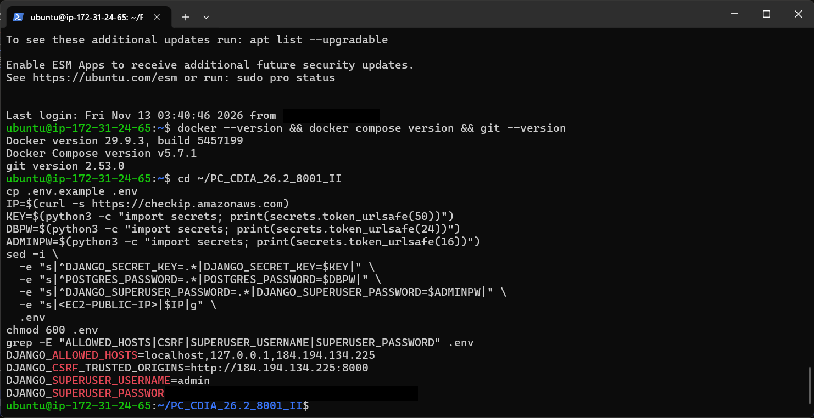
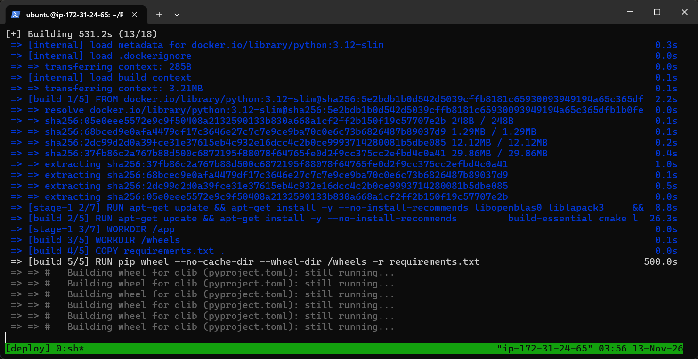
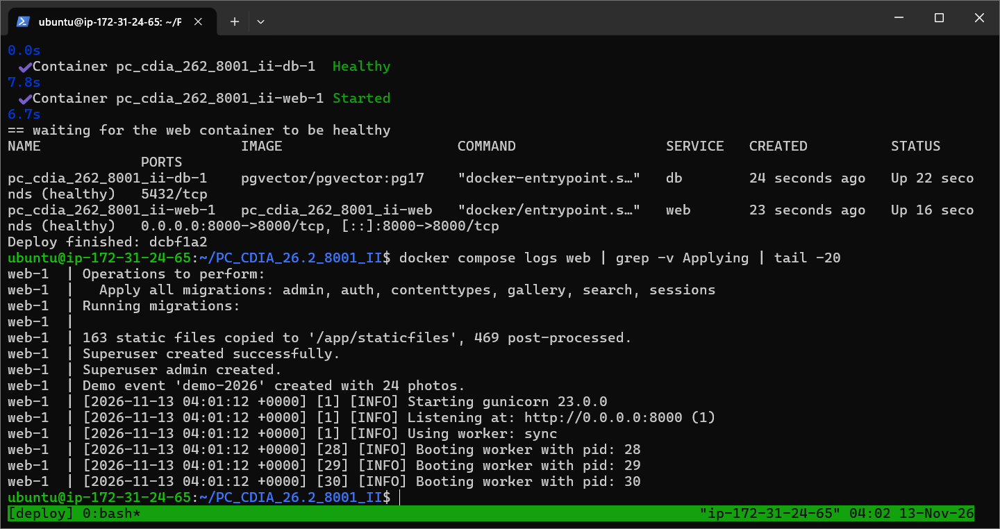
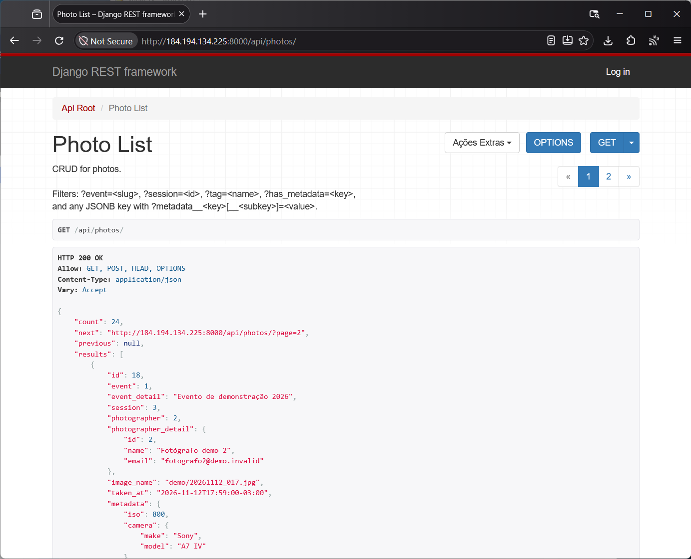
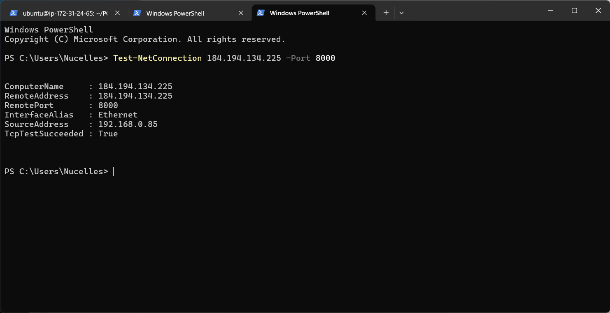
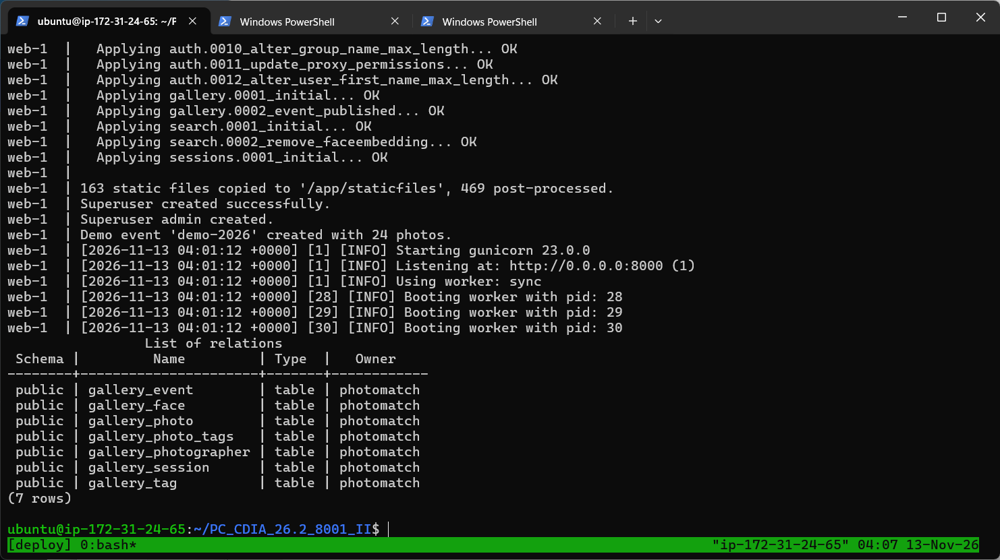
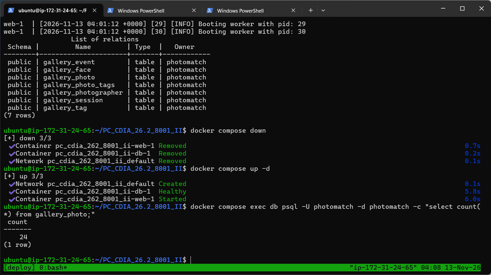

# Validação do Deploy (v1.0)

## SBrT PhotoMatch

**Fase:** Transição
**Data:** 13/11/2026
**Ambiente:** EC2 Ubuntu, IP público `184.194.134.225`, Docker Compose com `web` e `db`

---

## 1. Objetivo

Registrar as evidências de que a implantação descrita em [Atividades de Deploy](ativ_deploy.md) foi executada na EC2 e atende aos requisitos de deploy da AP2 (B1 a B8). Cada evidência foi capturada na própria instância ou no notebook do operador em 13/11/2026. Os trechos com senha e com o IP pessoal do operador foram cobertos antes da publicação.

## 2. Resumo

| Requisito | O que foi verificado | Resultado | Evidência |
|---|---|---|---|
| B1 | Security Group só com SSH (22, IP do operador) e API (8000); sem regra para 5432 | Atendido | [3.1](#31-security-group) |
| B1 | Docker, Docker Compose e Git instalados na EC2 | Atendido | [3.2](#32-ferramentas-na-ec2) |
| A7, B4 | `.env` criado só na EC2, com segredos gerados e o IP público | Atendido | [3.3](#33-variaveis-de-ambiente) |
| B2, B3 | Build da imagem `web` a partir do `Dockerfile` (dependências e dlib) | Atendido | [3.4](#34-build-da-imagem) |
| B2, B5 | `web` e `db` saudáveis; migrações, `collectstatic`, superusuário e Gunicorn no deploy | Atendido | [3.5](#35-containers-saudaveis-e-logs) |
| B6 | API acessível pelo IP público | Atendido | [3.6](#36-api-pelo-ip-publico) |
| B6 | Porta 8000 aberta para a internet | Atendido | [3.7](#37-porta-8000-acessivel) |
| B8 | Migrações aplicadas e tabelas criadas no PostgreSQL | Atendido | [3.8](#38-migracoes-e-tabelas) |
| B7 | Dados mantidos após `docker compose down` / `up` | Atendido | [3.9](#39-persistencia-do-volume) |

## 3. Evidências na EC2

### 3.1 Security Group

Regras de entrada do `photomatch-sg`: SSH (22) somente do IP do operador (coberto na imagem) e TCP 8000 aberto para a API. Não há regra para a porta 5432, então o PostgreSQL não é alcançável de fora. A saída é a padrão (todo o tráfego).

### 3.2 Ferramentas na EC2

Conexão SSH na instância e versões instaladas pelo `scripts/ec2-setup.sh`: Docker 29.9.3, Docker Compose v5.7.1 e Git 2.53.0.

### 3.3 Variáveis de ambiente

O `.env` foi criado na EC2 a partir do `.env.example`, com `DJANGO_SECRET_KEY`, `POSTGRES_PASSWORD` e a senha do superusuário gerados aleatoriamente, e com o IP público em `DJANGO_ALLOWED_HOSTS` e `DJANGO_CSRF_TRUSTED_ORIGINS`. O arquivo tem permissão `600` e não é versionado (`.gitignore`). O valor da senha foi coberto na imagem.

### 3.4 Build da imagem

Primeiro `sh scripts/deploy.sh` dentro do `tmux`. O estágio de build compila as dependências em wheels; a compilação do dlib é a etapa mais longa (mais de 8 minutos, como mostra a captura), como previsto em [Dimensionamento Computacional](../Elaboracao/dim_comp.md).

### 3.5 Containers saudáveis e logs

Ao final do deploy, `db` e `web` aparecem como `healthy`. O `web` publica `0.0.0.0:8000->8000/tcp` e o `db` só expõe 5432 na rede interna do Compose. Os logs mostram as migrações, os 163 arquivos estáticos copiados, a criação do superusuário, o evento de demonstração e o Gunicorn com 3 workers.

### 3.6 API pelo IP público

`GET http://184.194.134.225:8000/api/photos/` respondendo `200 OK` no navegador, com paginação, evento aninhado, fotógrafo aninhado e o JSONB `metadata`.

### 3.7 Porta 8000 acessível

Teste feito do notebook do operador com `Test-NetConnection 184.194.134.225 -Port 8000`: `TcpTestSucceeded : True`.

### 3.8 Migrações e tabelas

Migrações do Django e do app `gallery` aplicadas no deploy (incluindo `0002_event_published` e a remoção da tabela antiga da AP1), e as 7 tabelas `gallery_*` listadas com `\dt` no PostgreSQL do container `db`.

### 3.9 Persistência do volume

`docker compose down` remove os containers e a rede; `docker compose up -d` recria tudo. A contagem de `gallery_photo` é **24** antes e depois, porque os dados ficam no volume `pgdata`.

## 4. Verificações complementares (ambiente Docker local, mesma imagem)

Executadas em 11 a 13/11/2026 com a mesma imagem e o mesmo `docker-compose.yml`:

| Verificação | Resultado |
|---|---|
| Testes automatizados (`python manage.py test gallery search`) | 21 de 21 passando |
| Registro transacional com regra violada (`POST /api/photos/ingest/` com embedding de 2 valores) | 400 e nenhuma linha gravada em foto, etiqueta ou rosto |
| Índice GIN em `gallery_photo.metadata` | `CREATE INDEX photo_metadata_gin ... USING gin (metadata)` |
| Busca vetorial (`POST /api/search/`) | p50 2,7 ms e p95 4,2 ms |
| Busca por selfie na página, evento SBrT 2025 | foto de origem em primeiro lugar entre 49 resultados |
| Busca por selfie na página, evento Claude Impact Lab | foto de origem entre os 58 resultados |
| Backup e restauração (`scripts/backup.sh`, `scripts/restore.sh`) | 24 fotos restauradas e API respondendo |
| Proteção contra caminhos inválidos de foto (`..`, caminho absoluto) | 404 |

## 5. Rastreabilidade

| Requisito | Componente | Evidência |
|---|---|---|
| B1 Security Group e ferramentas | EC2, `photomatch-sg`, `scripts/ec2-setup.sh` | 3.1, 3.2 |
| B2 Dockerfile e Compose | `Dockerfile`, `docker-compose.yml` | 3.4, 3.5 |
| B3 psycopg e banco por ambiente | `requirements.txt`, `photomatch/settings.py` | 3.5, 3.8 |
| B4 Segredos fora do Git | `.env` na EC2, `.env.example` versionado | 3.3 |
| B5 Fluxo de deploy com migrações e `collectstatic` | `scripts/deploy.sh`, `docker/entrypoint.sh` | 3.5, 3.8 |
| B6 API e Admin pelo IP público | container `web`, porta 8000 | 3.6, 3.7 |
| B7 Persistência | volume `pgdata` | 3.9 |
| B8 Evidências no README | `README.md`, esta página | seção 3 |

## 6. Histórico de versões

| Versão | Data | Descrição | Autor |
|---|---|---|---|
| 1.0 | 13/11/2026 | Evidências do deploy na EC2 e verificações complementares | Nicholas Borges de Vasconcelos |
