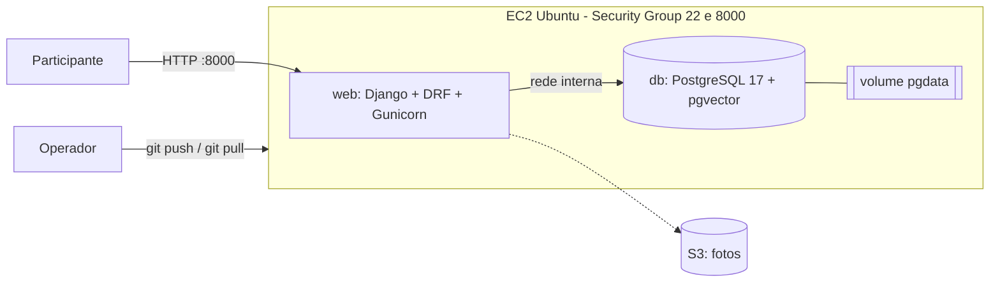

---
hide:
  - navigation
  - toc
---

  

    <h1 class="bdcc-title">
      PhotoMatch
    </h1>

    

      <section class="bdcc-card">
        <h2 class="bdcc-card__title">O que é</h2>
        

          API e site que encontram, a partir de uma selfie, as fotos de um evento em que a pessoa aparece. Usado ao vivo no SBrT 2026.
        

      </section>

      <section class="bdcc-card">
        <h2 class="bdcc-card__title">Arquitetura (AP2)</h2>
        

          

            Aplicação
            Django 5.2, Django REST Framework, Gunicorn
          

          

            Dados
            PostgreSQL 17: relacional, JSONB (GIN) e pgvector
          

          

            Infraestrutura
            EC2 + Docker Compose (web e db), volume persistente, S3
          

        

      </section>
    

  

## Documentação RUP

| Fase | Documentos |
|---|---|
| [Iniciação](Iniciacao/index.md) | [Documento de Visão](Iniciacao/dv.md), [Requisitos Suplementares](Iniciacao/rs.md) |
| [Elaboração](Elaboracao/index.md) | [Casos de Uso Arquiteturais](Elaboracao/cua.md), [Pacotes e Subsistemas](Elaboracao/maps.md), [Dimensionamento Computacional](Elaboracao/dim_comp.md), [Dimensionamento do Banco](Elaboracao/dimrbd.md), [Sequência e Comunicação](Elaboracao/seq_com.md) |
| [Transição](Transicao/index.md) | [Atividades de Deploy](Transicao/ativ_deploy.md) |

## Visão da arquitetura

O código, o passo a passo de execução e as evidências do deploy estão no [README do repositório](https://github.com/Projetos-de-Extensao/PC_CDIA_26.2_8001_II#readme).
